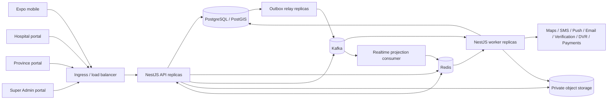

# Phase 1 — target architecture

## 1. Goals

The target platform must:

- serve the mobile app and all three administrative surfaces through one canonical API;
- isolate provider organizations and facilities while supporting explicitly delegated province and
  national oversight;
- make emergency booking, assignment, trip, tracking, and safety workflows transactionally safe;
- use the mandated NestJS/TypeScript, PostgreSQL/TypeORM, Redis, Kafka, BullMQ, Opossum, Pino, Jest,
  Docker, and Postman stack;
- scale API, realtime, event relay, and jobs horizontally without process-local correctness;
- permit later domain extraction without paying a microservice coordination cost on day one;
- migrate incrementally beside the legacy systems and support a controlled rollback.

## 2. Non-goals for the first production slice

- One-for-one parity with 508 Go route registrations or 125 Go table names.
- Reproduction of the declared 13-service deployment topology.
- Migration of portal mock records, demo wallets, sample trips, simulated telemetry, or local tokens.
- Card storage, wallet settlement, loyalty, gamification, pooling, negotiation, subscriptions,
  gift/family accounts, ML ETA, demand forecasting, or generalized multi-country pricing.
- Claiming DVR808, OCR, identity checks, maps, SMS, payments, or realtime delivery are production
  ready before provider-specific acceptance tests pass.

## 3. Architectural style

Use a **modular monolith with independently deployable runtime roles**. Domain modules share a
PostgreSQL cluster and code repository, but own their tables, application ports, and events. Other
modules cannot import their TypeORM repositories or mutate their entities directly.

This is a deployment decision, not a denial of domain boundaries. A module can be extracted when:

1. it has a stable contract and event schema;
2. its data ownership can be separated without cross-database transactions;
3. independent scale or release cadence is measured, not speculative; and
4. operational ownership exists for another service.

## 4. System context



All clients use the target API. No client receives database credentials, Kafka access, provider
secrets, or direct object-store read authority beyond short-lived scoped URLs.

## 5. Runtime roles

One codebase produces immutable images with an explicit startup role.

| Runtime | Responsibilities | Scale unit |
|---|---|---|
| `api` | REST controllers, auth, authorization, commands/queries, upload grants, WebSocket gateway, health | request rate and active connections |
| `worker` | BullMQ processors, Kafka consumers, provider delivery, projections, scheduled policy checks | queue lag and provider throughput |
| `outbox-relay` | Claims committed outbox rows and publishes to Kafka | outbox age/throughput |
| `migration` | Runs reviewed TypeORM migrations under advisory lock, then exits | one job per release |

`outbox-relay` may share the worker image but has a separate deployment and health signal. Multiple
relays are safe because rows are claimed with `FOR UPDATE SKIP LOCKED`; correctness never depends on
a singleton process.

## 6. Logical modules and ownership

| Module | Owns | Core responsibilities | Initial scope |
|---|---|---|---|
| Identity | users, auth identities, sessions, refresh families, MFA | OTP/password flows, token issue/rotation, session control | Required |
| Access Control | permissions, roles, role profiles, assignments, authority grants | Effective permission and scope decisions | Required |
| Tenancy | provider organizations, memberships, facilities | Tenant/facility lifecycle and context | Required |
| Geography | provinces, districts, municipalities, service areas | Nepal reference hierarchy and geo scope | Required |
| Provider Registry | applications, approvals, organization/facility compliance | Province/platform review workflow | Required |
| Workforce | driver/crew profiles, verification, duty state | Eligibility and facility relationship | Required |
| Fleet | ambulances, equipment, assignment, maintenance/readiness | Operational and compliance availability | Required |
| Documents | private object metadata, subject links, reviews, expiry | Upload/finalize/review/download policy | Required |
| Dispatch | service requests, fare quote, dispatch offers, acceptance | Search, offer expiry, atomic assignment | Required |
| Trips | assignments, trips, lifecycle history, cancellation | Controlled transitions and resource release | Required |
| Tracking | telemetry ingestion, latest position, durable breadcrumbs | Active-trip authorization and realtime projection | Required |
| Safety | SOS incidents, contacts, escalation, trip sharing | Emergency workflow and auditable delivery attempts | Required core |
| Communications | devices, preferences, notifications, delivery attempts | Push/SMS/email orchestration | Required core |
| Support | tickets, messages, escalation | Patient/provider/province support | Required basic |
| Feedback | ratings and comments | Post-completion feedback | Required basic |
| Billing | cash collection ledger, fare records, provider integrations | Financial truth, refunds, settlement | Cash ledger only |
| Governance | audit events, idempotency, outbox/inbox | Tamper-evident operational evidence | Required |
| Reporting | authorized read models and exports | Tenant/province/platform projections | Required basic |
| Integrations | maps, storage, messaging, verification, DVR, payment adapters | Anti-corruption boundary and provider resilience | As approved |

“Required” means architecture and core acceptance coverage, not that every portal report is in the
first deployable increment.

## 7. Clean Architecture dependency rules

The proposed implementation root is `backend-v2/`, created only after approval:

```text
backend-v2/
  apps/
    api/
    worker/
    outbox-relay/
  src/
    modules/
      <module>/
        domain/
          entities/
          value-objects/
          events/
          repositories/       # interfaces/tokens only
          services/
        application/
          commands/
          queries/
          dto/
          ports/              # outbound interfaces
          policies/
        infrastructure/
          persistence/typeorm/
          messaging/
          providers/
        presentation/
          http/
          websocket/
    shared/
      domain/
      application/
      infrastructure/
  migrations/
  test/
  postman/
  docker/
```

Rules enforced by ESLint boundaries and architecture tests:

1. `domain` imports no NestJS, TypeORM, HTTP, Redis, Kafka, or provider SDK.
2. `application` depends on domain and declared ports, never concrete infrastructure.
3. `infrastructure` implements repository/provider/event ports and maps persistence records to
   domain objects.
4. `presentation` validates transport DTOs, invokes one application use case, and maps results; it
   contains no business transition logic.
5. TypeORM entities remain infrastructure models. Domain entities are not decorated persistence
   records.
6. A module may consume another module through an application port, immutable query projection, or
   versioned event—never by importing its repository.
7. Shared code contains true cross-cutting primitives only (IDs, money, clock, result/error types,
   transaction context), not a “common services” dumping ground.

## 8. Command, query, and transaction model

- Every mutation is a named command such as `AcceptDispatchOffer`, `AssignCrew`,
  `AdvanceTripToPickup`, or `ReviewDocument`; generic entity PATCH is avoided for stateful
  aggregates.
- Commands load aggregates through repository interfaces, enforce domain invariants, persist state,
  append history/audit evidence, and insert outbox events plus required job intents in **one
  PostgreSQL transaction**.
- Commands accept an idempotency key where client retries could duplicate effects. The stored key is
  scoped by actor, route, and tenant and includes a canonical request hash.
- A correctness invariant spanning Dispatch, Trips, Workforce, or Fleet is coordinated through
  those modules' application command/policy ports while they participate in the same unit of work.
  The coordinator never imports another module's repository, and a later Kafka consumer is never
  the missing half of an assignment or resource-release transaction.
- Queries return purpose-built projections and always apply subject/scope rules. They do not expose
  TypeORM entities.
- Optimistic versions protect ordinary updates. Assignment acceptance and other contention points
  additionally use row locks/conditional updates and database uniqueness constraints.
- Dates are UTC instants; Nepal display time belongs at the presentation edge. Money is
  `{ amountMinor: bigint, currency: 'NPR' }` internally and serialized as a safe decimal/string
  contract, never floating point.

### 8.1 Request-scoped database context

Authentication produces an immutable `RequestContext` containing principal, session, selected
tenant/facility scope, authority grant, correlation ID, and trace context. An interceptor opens a
TypeORM `QueryRunner` transaction and uses `SET LOCAL` for PostgreSQL RLS claims. Repositories use
only that transaction manager.

This design prevents pooled connections from retaining a previous request's tenant settings. The
same context protocol applies to workers; a worker cannot run tenant-owned work without an explicit
tenant in its job/event envelope.

## 9. Persistence

- PostgreSQL is the source of truth for transactional state; PostGIS supports service areas and
  spatial lookup where justified.
- TypeORM migrations are forward-only in production. `synchronize: false` is invariant.
- Schemas are logically grouped by module, or tables use module prefixes if operational tooling
  requires one schema. In either case, table ownership is documented.
- Tenant-owned uniqueness and foreign keys include `tenant_id`.
- High-volume `location_points` and `audit_events` are time-partitioned with explicit retention and
  archive policy.
- Read-heavy dashboards use indexed query projections or asynchronously maintained read models,
  not unrestricted joins from portal clients.
- The transactional outbox and durable BullMQ job intents are in PostgreSQL; Kafka acknowledgement
  and BullMQ enqueue metadata never change the already-committed domain state.

The logical ERD and ownership classes are in
[phase-1-data-model-and-lifecycles.md](./phase-1-data-model-and-lifecycles.md).

## 10. Messaging responsibilities

### Kafka

Kafka carries versioned domain events and telemetry streams between modules/runtimes. Domain events
originate from the outbox. Consumers use an inbox/deduplication key and assume at-least-once
delivery. Aggregate ID is the partition key when ordering matters.

### BullMQ

BullMQ handles delayed, scheduled, retryable, or provider-facing work: offer expiry, reminders,
document scans, notification delivery, exports, and reconciliation. A BullMQ job is not published as
an alternative copy of every domain event. Required work is first recorded as a PostgreSQL job
intent and then enqueued with a deterministic ID so Redis loss cannot erase it.

### Redis

Redis holds bounded caches, distributed rate-limit counters, WebSocket adapter state, latest
telemetry projections, short-lived challenges, and BullMQ data. It is not the source of truth for
bookings, permissions, audit, money, or provider approval.

Detailed event and job catalogs are in
[phase-1-events-jobs-integrations.md](./phase-1-events-jobs-integrations.md).

## 11. Realtime and tracking

1. The driver app opens an authenticated, active-trip-scoped channel and submits point batches with
   client-generated point IDs and monotonic capture times.
2. The API validates session, assignment, trip state, coordinate bounds, timestamp skew, rate, and
   sequence; tenant/driver/trip identifiers are derived or cross-checked server-side.
3. Accepted telemetry enters a dedicated Kafka telemetry topic. This is an ingress stream, not a
   database/outbox dual write.
4. Consumers idempotently update a short-TTL latest-position projection in Redis and sample durable
   points into partitioned PostgreSQL storage.
5. Realtime gateway replicas fan authorized updates through the Redis adapter. Every subscription is
   authorized on join and rechecked when assignment/session/authority changes.
6. Trip transitions themselves remain PostgreSQL transactions with outbox events. Redis or socket
   delivery never declares a trip complete.

Backpressure may reduce breadcrumb sampling or UI update frequency, but it cannot skip an emergency
or lifecycle command. GPS quality (`LIVE`, `LAST_KNOWN`, `STALE`, `UNAVAILABLE`) is derived from age
and device signals rather than manually conflated with ambulance operational status.

## 12. Caching and correctness

| Data | Cache policy | Failure behavior |
|---|---|---|
| Geography/reference data | cache-aside, versioned, minutes-hours TTL | read PostgreSQL |
| Fare/config projections | cache-aside by published version | use last explicitly valid version or fail quote; never invent price |
| RBAC projection | short TTL + assignment version + invalidation event | query PostgreSQL or deny; never allow from stale positive cache |
| Latest GPS | Redis TTL and sequence compare | report stale/unavailable, not a fabricated point |
| Sessions/revocation | Redis acceleration backed by PostgreSQL | sensitive actions consult DB/deny if revocation cannot be established |
| API response | only explicitly public/non-sensitive GET projections | bypass cache |

Database constraints, not distributed locks, enforce assignment uniqueness and state correctness.
Locks may reduce duplicate work but are never the only protection.

## 13. Horizontal scaling

- API containers are stateless; no in-memory sessions, MFA challenges, throttles, subscriptions, or
  tenant caches are authoritative.
- WebSockets use a Redis adapter and authenticated room names containing opaque server-derived
  scope IDs.
- Kafka consumer groups partition work; consumers commit offsets only after idempotent effects.
- BullMQ workers scale per queue and use stable deduplication job IDs.
- Outbox relays safely share work with row claiming.
- PostgreSQL connection limits are budgeted per deployment; use managed pooling/PgBouncer where
  supported, with transaction-mode compatibility tested for `SET LOCAL`.
- Files go directly from clients to private storage through short-lived presigned upload grants,
  then require server finalization; API pods do not buffer large uploads.
- Read replicas are optional only for lag-tolerant reporting. Authorization and post-command reads
  use the primary unless consistency is explicitly managed.

## 14. Architecture decisions

| ADR | Decision | Reason | Revisit trigger |
|---|---|---|---|
| ADR-001 | Provider organization is tenant root | Supports one or many facilities without making province a commercial tenant | Product rejects organization/facility model |
| ADR-002 | Modular monolith, separate runtime roles | Preserves transactions and lowers operational load while retaining boundaries | Measured independent scale/release need |
| ADR-003 | Canonical rebuild, not direct port | Source models conflict and broad legacy surface is untested | Never; mappings can evolve |
| ADR-004 | Kafka + outbox/inbox replaces NATS behavior | Durable, traceable integration without commit/publish gap | Approved platform constraint changes |
| ADR-005 | BullMQ only for operational work | Prevents two competing domain buses | A job becomes a true cross-domain fact |
| ADR-006 | REST + authenticated WebSocket | Fits mobile/portal commands and live updates | Proven need for another client protocol |
| ADR-007 | PostgreSQL RLS plus app authorization | Defense in depth for high-impact multitenancy | Never remove without equivalent proof |
| ADR-008 | Custom data-driven RBAC | Required permission → role → profile → user hierarchy and dynamic scope | Never replace with hard-coded role strings |
| ADR-009 | No Swagger runtime/artifact | Explicit project constraint | Owner changes constraint |
| ADR-010 | Strangler deployment in `backend-v2/` | Protects legacy and permits rollback | Cutover complete and archive approved |
