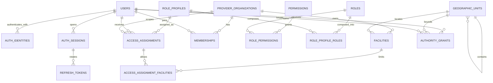
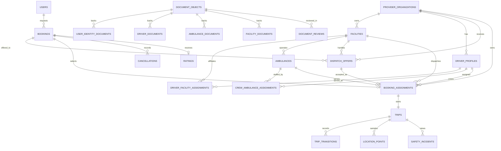
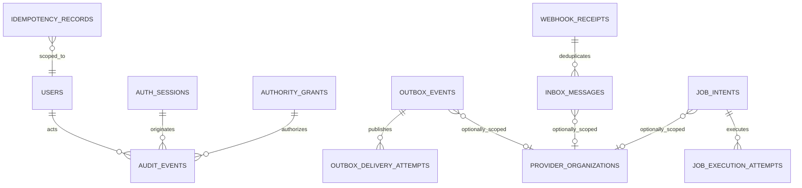
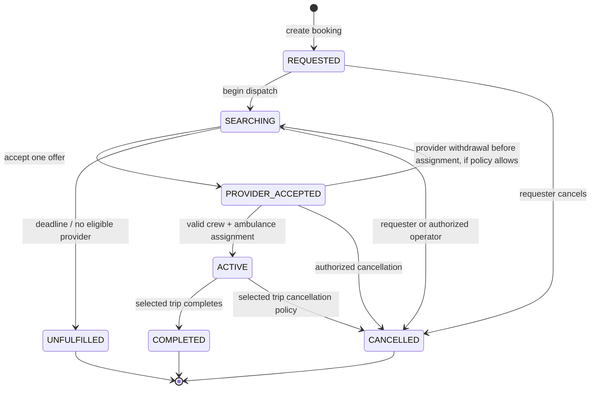
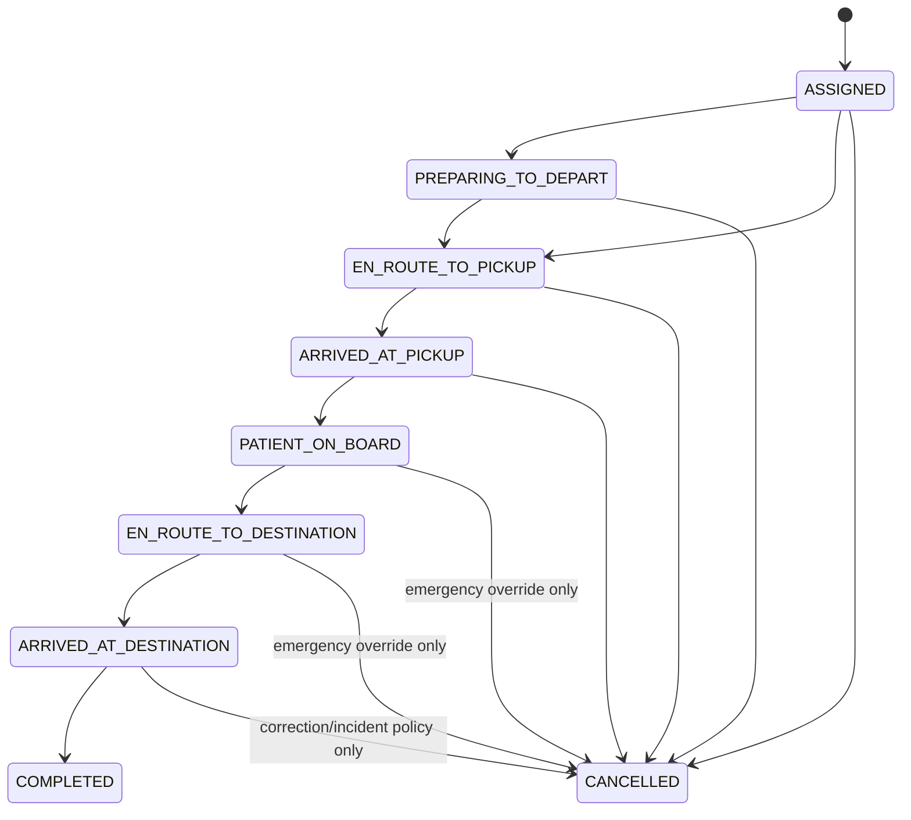
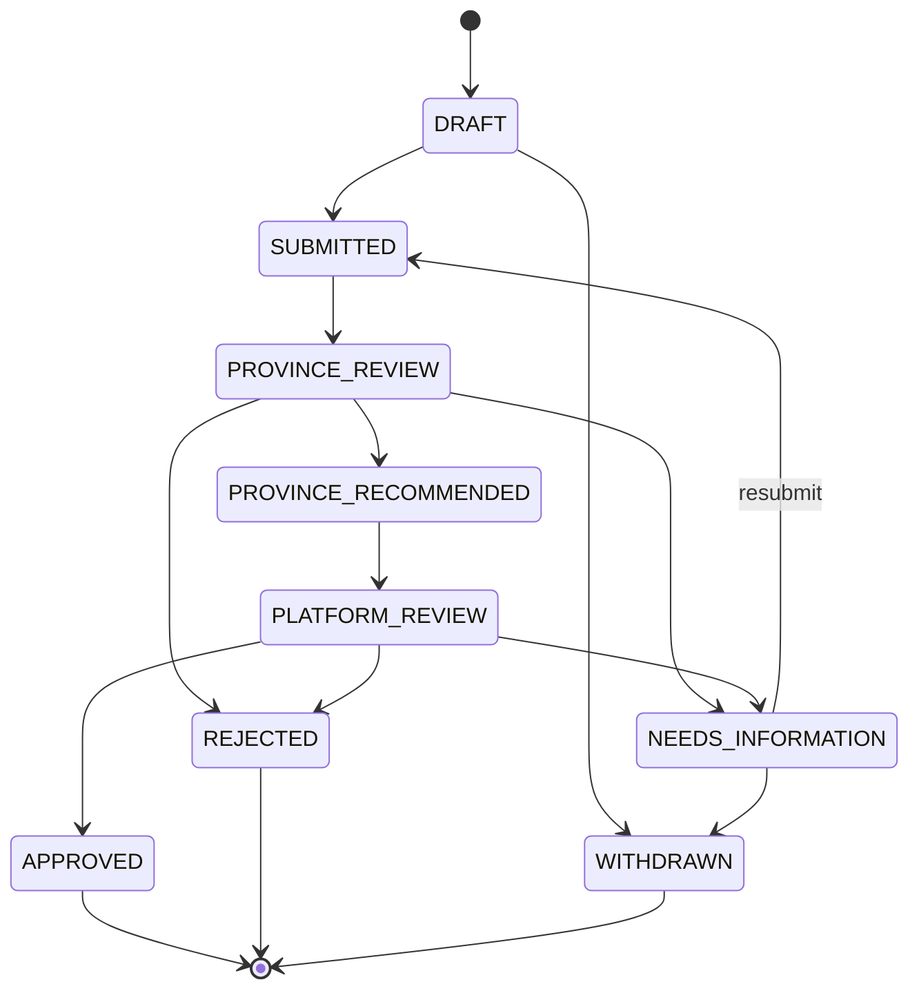

# Phase 1 — target data model and lifecycles

This is the approved-design candidate, not executable DDL. Physical TypeORM entities and
forward-only migrations are created only after the Phase 1 gate. Names may be refined during that
implementation, but ownership classes and invariants cannot be weakened without a reviewed ADR.

## 1. Modeling conventions

- PostgreSQL `uuid` identifiers are generated by the application using a time-sortable UUID scheme
  selected and tested during implementation.
- Every mutable aggregate has `version`, `created_at`, and `updated_at`; concurrency commands compare
  `version` or lock the row.
- Tenant-owned records have `tenant_id NOT NULL`; facility-owned records also have
  `facility_id NOT NULL`.
- External identifiers (booking reference, plate, licence, citizenship, provider registration) are
  separate from internal IDs and normalized in dedicated fields or hashes.
- UTC instants use `timestamptz`; local calendar dates use `date`; no server-local timestamp type.
- Monetary values use signed `bigint` minor units plus a three-character ISO currency. Nepal
  defaults to `NPR`; calculations never use floating point.
- Coordinates use validated WGS84 values and PostGIS geography where spatial queries need it.
- Statuses use explicit text/check constraints and domain constants. TypeORM schema synchronization
  is never used to infer them.
- JSON is reserved for immutable provider payload snapshots, policy metadata, and event payloads;
  query-critical business fields are relational columns.
- Deletion behavior is explicit. Audit, transition, payment, and event records are not cascade-
  deleted. PII erasure uses a reviewed anonymization workflow.

## 2. Identity, access, and tenancy ERD



### 2.1 Core catalog

| Table | Ownership class | Purpose and key constraints |
|---|---|---|
| `users` | principal | Canonical person/workload principal; lifecycle and token version |
| `user_profiles` | principal | Names/contact/preferences separated from credentials; sensitive fields encrypted/masked |
| `auth_identities` | principal | Normalized phone/email/password/provider identity; verified state; uniqueness by identity type |
| `auth_sessions` | principal | Device/session, assurance, idle/absolute expiry, revocation/risk |
| `refresh_tokens` | principal | Hashed one-time token, family, predecessor/successor, use/revoke metadata |
| `mfa_factors` | principal/restricted | Encrypted TOTP/WebAuthn metadata and recovery state |
| `otp_challenges` | principal/restricted | Hashed single-use code, purpose, attempts, TTL; aggressively retained |
| `provider_organizations` | tenant root | Legal/operating provider; `id` is the tenant identifier |
| `facilities` | tenant | Hospital/base; composite unique `(tenant_id, id)` and geography |
| `memberships` | tenant | User relationship/status with provider; no permissions by itself |
| `permissions` | global reference | Immutable atomic action code and risk class |
| `roles` | system or tenant | Versioned permission bundle; checked owner shape |
| `role_permissions` | system or tenant | Role-to-permission relation |
| `role_profiles` | system or tenant | Versioned role composition and scope ceiling |
| `role_profile_roles` | system or tenant | Profile-to-role relation |
| `access_assignments` | tenant/scoped | User/profile/tenant, explicit `TENANT` or `FACILITY_SET` scope type, validity, delegation evidence, version |
| `access_assignment_facilities` | tenant/scoped | Required non-empty allowlist for `FACILITY_SET`; forbidden for `TENANT`, so empty never means wildcard |
| `authority_grants` | platform workflow | Province/platform geography/action/resource/purpose scope, approvals, expiry/revocation |
| `geographic_units` | global reference | Nepal hierarchy: country, province, district, municipality/ward as approved |
| `provider_applications` | platform workflow | Pre-tenant registration/review; approval creates organization/facility atomically |
| `provider_application_reviews` | platform workflow | Append-only province/platform review decisions and reasons |

System-owned and tenant-owned role/profile rows use an explicit owner shape such as
`owner_type = SYSTEM|TENANT` plus a check requiring `tenant_id` only for `TENANT`. Null never means
“unrestricted.”

## 3. Operations ERD



### 3.1 Workforce and fleet

| Table | Ownership | Purpose and constraints |
|---|---|---|
| `driver_profiles` | tenant | User link, licence metadata, verification/account/duty states; one active profile per tenant/user |
| `driver_facility_assignments` | tenant + facility | Time-bounded affiliation when drivers can serve multiple approved facilities |
| `ambulances` | tenant + facility | Plate/VIN/category, regulatory and operational state, readiness version |
| `ambulance_equipment` | tenant + facility | Typed equipment presence, calibration/expiry, readiness impact |
| `crew_ambulance_assignments` | tenant + facility | Temporal driver/crew-to-ambulance assignment; no overlapping active assignment where prohibited |
| `maintenance_records` | tenant + facility | Planned/unplanned maintenance, odometer, release evidence |
| `device_bindings` | tenant + facility | GPS/DVR terminal to ambulance mapping; provider and allowlist state |

Do not store one overloaded `status` for a driver or ambulance. See the state dimensions in section
8.

### 3.2 Booking, dispatch, and trip

| Table | Ownership | Purpose and constraints |
|---|---|---|
| `bookings` | platform workflow + requester | Patient service request, route, urgency, high-level lifecycle, requester, encrypted patient/contact data |
| `fare_quotes` | platform workflow | Versioned quote inputs/output in minor units; provider/config provenance |
| `dispatch_offers` | tenant + facility | Minimal request projection offered to one provider/facility; deadline and response |
| `booking_assignments` | tenant + facility | Accepted offer, driver, ambulance, dispatcher, assignment times; one selected assignment per booking |
| `trips` | tenant + facility | Detailed transport lifecycle, odometer/distance/fare completion evidence |
| `trip_transitions` | tenant + facility, append-only | From/to state, actor, reason, command/idempotency key, timestamp, aggregate version |
| `cancellations` | requester or tenant, append-only | Cancelling actor class, policy code, reason, fees/waiver, lifecycle point |
| `location_points` | tenant + trip, partitioned | Deduplicated sampled GPS data, sequence, accuracy/quality, capture/receive times |
| `ratings` | requester + selected assignment | One passenger rating per completed booking, moderation state |

Key database constraints:

- unique accepted `dispatch_offer` per booking;
- unique `booking_assignment.booking_id` for the selected assignment;
- one active trip per assignment;
- partial unique active assignment for an ambulance and, according to staffing policy, driver;
- assignment's tenant/facility must match offer and ambulance composite foreign keys; the driver
  shares the tenant and has an active affiliation with that facility;
- terminal booking/trip states cannot transition through generic updates;
- location point uniqueness by `(trip_id, source_device_id, point_id)` and sequence checks;
- rating requires a completed selected assignment and the booking requester.

### 3.3 Documents

| Table | Ownership | Purpose |
|---|---|---|
| `document_objects` | principal or tenant, restricted | Private object key, hash, size, detected MIME, encryption/key version, scan state |
| `user_identity_documents` | principal | Citizenship/identity subject link and expiry metadata |
| `driver_documents` | tenant | Licence/certification subject link |
| `ambulance_documents` | tenant + facility | Bluebook, insurance, fitness, pollution, equipment calibration |
| `facility_documents` | tenant + facility | Registration/operating licence/compliance evidence |
| `document_reviews` | scoped append-only | Reviewer/grant, decision, reason, extracted-field snapshot, supersession |

Separate subject-link tables preserve real foreign keys. A generic unvalidated
`subject_type/subject_id` pair is not accepted for restricted documents.

### 3.4 Safety, communications, support, and finance

| Table | Ownership | Purpose |
|---|---|---|
| `emergency_contacts` | principal | User-managed trusted contacts with verification state |
| `safety_incidents` | principal/tenant trip | SOS, deviation, safety escalation and resolution state |
| `safety_incident_events` | append-only | Timeline and delivery/escalation outcomes |
| `notification_preferences` | principal | Channel/category consent and quiet hours |
| `push_devices` | principal | Rotating push token, device, platform, invalidation state |
| `notifications` | principal | User-visible inbox item with source aggregate |
| `delivery_attempts` | principal/tenant | Provider/channel request, status, provider reference, safe error code |
| `support_tickets` | principal or tenant | Explicit scope shape, category, priority, assignment and status |
| `support_messages` | same as ticket | Authored timeline with restricted attachments |
| `cash_collection_records` | tenant trip | Expected/recorded cash, collector, reconciliation status |
| `payment_intents` | principal/tenant | Future external provider intent; idempotency and minor-unit amount |
| `ledger_entries` | finance append-only | Balanced entries; never mutable/deleteable |

External payments beyond cash remain gated, but the model prevents a future provider callback from
mutating trip truth directly.

## 4. Governance and messaging ERD



| Table | Purpose/invariant |
|---|---|
| `audit_events` | Append-only authorization/business evidence, partitioned and archived |
| `idempotency_records` | Actor + context + operation + key, canonical request hash, stored outcome/expiry |
| `outbox_events` | Event envelope/payload, aggregate version, and ordering-stream sequence inserted with state transaction |
| `outbox_delivery_attempts` | Publish diagnostics; event itself is immutable |
| `inbox_messages` | Consumer/event ID uniqueness and handler result for idempotency |
| `job_intents` | Durable versioned requirement for delayed/provider work, inserted with business state before BullMQ enqueue |
| `job_execution_attempts` | Append-only enqueue/claim/result diagnostics linked to a deterministic BullMQ job ID |
| `webhook_receipts` | Provider/event ID, signature/timestamp validation, payload hash, processing state |
| `integration_accounts` | Tenant/provider binding and non-secret configuration; secret reference only |
| `report_exports` | Requester/context/filter snapshot, object reference, expiry, download audit |

An outbox row may be deliberately global or carry a non-null tenant. Null is permitted only when
the event's aggregate ownership class is global/platform and is validated against event metadata.

## 5. Booking and trip lifecycles

The sources overload one status with request, dispatch, assignment, and transport. The target
separates a high-level booking lifecycle from the detailed selected trip lifecycle.

### 5.1 Booking lifecycle



Rules:

- `REQUESTED` is the first persisted state; an incomplete mobile draft stays client-side or in a
  separate expiring draft API, never masquerades as an active request.
- `SEARCHING` creates scoped offers; providers do not list all pending bookings.
- Offer acceptance locks the booking, conditionally changes it from `SEARCHING`, marks exactly one
  offer accepted, supersedes others, and writes assignment/outbox/audit data in one transaction.
- If acceptance includes an eligible driver and ambulance, the command may record
  `PROVIDER_ACCEPTED` and `ACTIVE` history in one transaction. The intermediate fact is still
  retained.
- Terminal states are immutable except a separately modeled, audited correction workflow; reopening
  creates a new booking linked to the prior one.

### 5.2 Dispatch-offer lifecycle

```text
PENDING ──► ACCEPTED
   ├──────► DECLINED
   ├──────► EXPIRED
   ├──────► WITHDRAWN
   └──────► SUPERSEDED
```

Only `PENDING` can be accepted. Expiry is checked against database time inside the acceptance
transaction, not only by a delayed job. A BullMQ expiry job improves timeliness but is not the
correctness boundary.

### 5.3 Trip lifecycle



Every arrow is a named command with an actor policy and append-only transition record. The usual
actor is assigned crew or an authorized facility dispatcher. Province/platform staff observe and
escalate; intervention requires `dispatch.override`, an authority grant, recent MFA, and a reason.

Completion atomically:

- validates destination arrival or approved override evidence;
- records completion measurements and final fare provenance;
- transitions trip and booking;
- releases active driver/ambulance assignment and derives availability;
- creates cash-collection/receipt work as applicable;
- inserts domain events and audit evidence.

### 5.4 Cancellation

Cancellation is a command, not `PATCH status`:

- actor class and relationship are resolved server-side;
- allowed lifecycle points and required reason codes depend on requester/provider/crew/authority;
- patient-on-board cancellation requires emergency/operations override;
- policy version and any fee/waiver are stored;
- resources are released only after selected assignment/trip changes commit;
- repeated calls with the same idempotency key return the original outcome.

## 6. Source status mappings

Mappings are explicit migration/API-adapter rules. Ambiguous source rows enter a reconciliation
queue rather than being guessed.

### 6.1 Mobile/Supabase booking mapping

| Source | Target |
|---|---|
| `draft` | client draft; no active booking, or separately imported draft if explicitly required |
| `pending` | booking `SEARCHING` (or `REQUESTED` if no dispatch-start evidence) |
| `assigned` | booking `ACTIVE`; trip `ASSIGNED` |
| `arriving` | trip `EN_ROUTE_TO_PICKUP` |
| `arrived` | trip `ARRIVED_AT_PICKUP` |
| `started` | trip `PATIENT_ON_BOARD`; advance to destination state only with evidence |
| `completed` | trip + booking `COMPLETED` |
| `cancelled` | booking/trip `CANCELLED` with imported reason |
| `rejected` | booking `UNFULFILLED`, unless evidence shows only one offer was declined |

### 6.2 Go ride mapping

| Source | Target |
|---|---|
| `requested` | booking `REQUESTED` or `SEARCHING` based on dispatch evidence |
| `accepted` | `PROVIDER_ACCEPTED`; `ACTIVE/ASSIGNED` only if valid driver/vehicle relationship exists |
| `in_progress` | manual/evidence-based trip state; never automatically treated as patient on board |
| `completed` | completed after fare/time/assignment reconciliation |
| `cancelled` | cancelled with actor/reason if available |

### 6.3 Portal mapping

| Portal vocabulary | Target |
|---|---|
| Requested / New | booking `REQUESTED` |
| Awaiting Provider Response / Awaiting Response | booking `SEARCHING` |
| Accepted / Request Accepted | booking `PROVIDER_ACCEPTED` |
| Ambulance Assigned / Assigned | booking `ACTIVE`, trip `ASSIGNED` |
| Preparing to Depart | trip `PREPARING_TO_DEPART` |
| En Route to Pickup | trip `EN_ROUTE_TO_PICKUP` |
| Arrived at Pickup | trip `ARRIVED_AT_PICKUP` |
| Patient Transport in Progress / Active Trip | trip `PATIENT_ON_BOARD` or `EN_ROUTE_TO_DESTINATION` based on timeline |
| Arrived at Destination | trip `ARRIVED_AT_DESTINATION` |
| Completed | booking/trip `COMPLETED` |
| Cancelled | booking/trip `CANCELLED` |
| Unfulfilled | booking `UNFULFILLED` |

## 7. Provider/facility onboarding lifecycle



Approval creates or activates the tenant/facility and initial access assignment in one transaction.
Post-approval operating state is separate: `ACTIVE`, `SUSPENDED`, `CLOSED`. A province reviewer may
recommend; final approval authority is a product/legal decision recorded in the authority policy.

## 8. Separate state dimensions

### 8.1 Driver

| Dimension | Values |
|---|---|
| Verification | `PENDING`, `NEEDS_INFORMATION`, `VERIFIED`, `REJECTED`, `EXPIRED` |
| Account | `ACTIVE`, `SUSPENDED`, `DEACTIVATED` |
| Duty | `OFF_DUTY`, `AVAILABLE`, `RESERVED`, `ON_TRIP`, `UNAVAILABLE` |

A driver is dispatch-eligible only when verification/account are valid, duty is available, required
documents are current, facility assignment is active, and no active trip conflicts.

### 8.2 Ambulance

| Dimension | Values |
|---|---|
| Approval/compliance | `PENDING_REVIEW`, `APPROVED`, `NEEDS_INFORMATION`, `REJECTED`, `SUSPENDED`, `EXPIRED` |
| Operational | `OFFLINE`, `AVAILABLE`, `RESERVED`, `DISPATCHED`, `MAINTENANCE`, `OUT_OF_SERVICE` |
| GPS quality | `LIVE`, `LAST_KNOWN`, `STALE`, `UNAVAILABLE` |

Operational availability is derived through commands and active assignment constraints. A user
cannot set an ambulance on an active trip to `AVAILABLE`.

### 8.3 Documents

| Dimension | Values |
|---|---|
| Upload/scan | `PENDING_UPLOAD`, `UPLOADED`, `QUARANTINED`, `SCANNING`, `READY`, `FAILED`, `REMOVED` |
| Review | `NOT_SUBMITTED`, `PENDING`, `APPROVED`, `NEEDS_INFORMATION`, `REJECTED`, `EXPIRED`, `REVOKED` |

Replacing a document creates a new object/link version. Prior evidence is superseded, not silently
overwritten. Expiry is derived by policy/job but enforced at dispatch time from database dates.

## 9. Integrity rules that must exist in both domain and database layers

1. A facility, driver, ambulance, offer, assignment, and trip in one operation share `tenant_id`.
2. A facility belongs to exactly one tenant and cannot be changed by a normal update.
3. Only one offer can win a booking; only one selected assignment and active trip can exist.
4. A driver/ambulance cannot have overlapping active trips under normal policy.
5. Only eligible resources can be assigned; expiry and suspension checks occur inside the
   transaction.
6. Booking/trip terminal states cannot be left through ordinary commands.
7. A location point must belong to the authenticated assigned device/crew and active trip.
8. Ratings, receipts, and cash records reference the selected completed assignment.
9. Role/profile/assignment changes cannot exceed the delegator's permissions/scope.
10. Authority grants are valid only within time/geography/action/resource bounds.
11. Outbox event `(aggregate_type, aggregate_id, aggregate_version, event_type)` and ordering-stream
    position `(stream_type, stream_id, stream_sequence)` are unique.
12. Inbox consumer/event ID and idempotency actor/context/key are unique.
13. A required BullMQ operation has one durable job intent and deterministic queue identity; queue
    loss cannot erase the requirement to execute or reconcile it.
14. Restricted document bytes cannot become public objects or be addressed by client-chosen paths.
15. Audit and transition rows are insert-only for application roles.

These invariants form mandatory migration and concurrency test cases, not comments in entity files.
